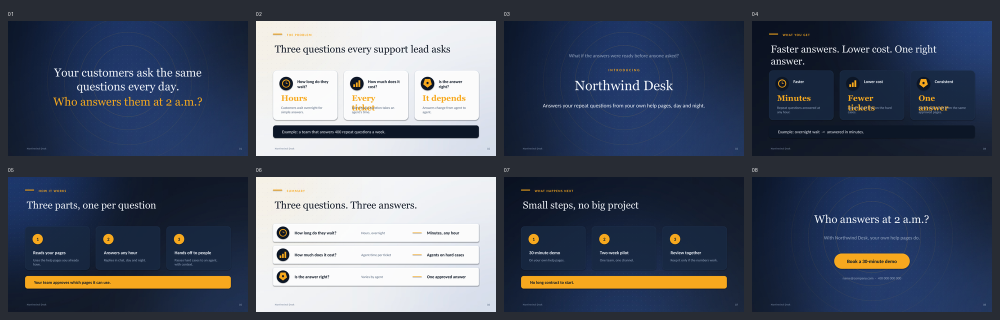

# Pitching-skill: Pitch Deck Builder

An AI skill that plans and builds a persuasive pitch deck for a non-technical audience:
a 5W1H brief, a 6-step story, sourced evidence, then an editable 16:9 PowerPoint with
speaker notes, rendered and checked automatically.

It follows the open [Agent Skills](https://agentskills.io/specification) format, so the
same folder works in Kiro Crew, Claude (Claude Code, claude.ai, API), ChatGPT / Codex,
and other apps that read `SKILL.md`.

> ภาษาไทยอยู่ด้านล่าง ([ข้ามไปภาษาไทย](#ภาษาไทย))



## Quick install

**Claude Code** (two commands, inside Claude Code):
```
/plugin marketplace add auaii/Pitching-skill
/plugin install pitch-deck-builder@auaii-pitching
```

**Codex CLI / ChatGPT desktop** (in your terminal):
```bash
codex plugin marketplace add auaii/Pitching-skill
codex plugin add pitch-deck-builder@auaii-pitching
```

**Any agent at once** (Claude Code, Codex, Cursor, Gemini CLI and more), with Node.js:
```bash
npx skills add auaii/Pitching-skill -g
```

Then ask: *"Build a pitch deck for ..."*. Updates later:
`/plugin marketplace update auaii-pitching` (Claude Code) or
`codex plugin marketplace upgrade auaii-pitching` (Codex).
Other apps (Kiro Crew, claude.ai, ChatGPT web) are in [Install](#install).

## What's inside

```
skills/pitch-deck-builder/     <- the skill (copy or upload this folder)
  SKILL.md                     principles + 7-stage workflow (loaded when the skill runs)
  references/                  read on demand: structure, layouts, design rules,
                               speaker-notes format, gotchas, a worked example
  assets/                      templates: brief, outline, objection prep
  scripts/
    deck_kit.py                python-pptx helpers, one function per slide layout
    example_deck.py            a complete 8-slide deck to copy as a start
    gen_backgrounds.py         paints background images with code (no image AI needed)
    render.sh                  .pptx -> PDF -> PNG per slide + contact sheet
    contact_sheet.py           used by render.sh
    audit.py                   checks any .pptx against the rules
  agents/openai.yaml           display info for ChatGPT / Codex
  requirements.txt
.claude-plugin/                Claude Code plugin + marketplace manifests
.codex-plugin/plugin.json      Codex / ChatGPT plugin manifest
.agents/plugins/marketplace.json  Codex marketplace catalog
install.sh                     copies the skill for Kiro Crew / Claude Code / Codex
tools/package.sh               builds the ZIP for upload-based apps
platforms/chatgpt-custom-gpt.md  setup for ChatGPT without Skills (Custom GPT / Project)
```

## Install

| App | How |
|---|---|
| **Kiro Crew** | Settings -> Skills -> Discover -> type `auaii/Pitching-skill` -> install. Or `./install.sh kiro` |
| **Claude Code** | Plugin (see [Quick install](#quick-install)), or `./install.sh claude` (copies to `~/.claude/skills/`) |
| **claude.ai** (web/desktop) | Download `pitch-deck-builder.zip` from [Releases](https://github.com/auaii/Pitching-skill/releases) -> Settings -> Capabilities -> Skills -> Upload |
| **Claude API** | Upload the folder through the Skills API |
| **ChatGPT desktop / Codex CLI** | Plugin (see [Quick install](#quick-install)), or `./install.sh codex` (copies to `~/.agents/skills/`). Mention it with `@` (ChatGPT) or `$` (Codex) |
| **ChatGPT web, no Skills** | Follow [platforms/chatgpt-custom-gpt.md](platforms/chatgpt-custom-gpt.md) to make a Custom GPT |
| **Other Agent Skills apps** | `npx skills add auaii/Pitching-skill`, or copy `skills/pitch-deck-builder/` into the app's skills folder |

```bash
git clone https://github.com/auaii/Pitching-skill.git
cd Pitching-skill
./install.sh            # installs for every app it finds on this computer
./install.sh all        # or: kiro | claude | codex
```

An existing copy is moved to `<app>/skill-backups/` first, never deleted.

**Optional tools for building and checking the .pptx:**
Python 3.9+ with `pip install -r skills/pitch-deck-builder/requirements.txt`,
LibreOffice, and poppler (`pdftoppm`). On macOS:
`brew install --cask libreoffice && brew install poppler`.
Without them the skill still works in **content mode**: it delivers the brief, outline,
slide-by-slide spec and speaker notes.

## Use

Ask in plain words, in any language:

- "Build a pitch deck for our helpdesk product. The audience is the CFO and sales directors, 20 minutes."
- "ช่วยทำสไลด์ pitch ขายระบบ CRM ให้ผู้บริหารที่ไม่ใช่สายเทคนิค"

The skill then works in 7 stages, and stops for your agreement after the brief, the
chosen points and the outline.

Run the tools yourself:

```bash
cd skills/pitch-deck-builder/scripts
python gen_backgrounds.py --out build/bg
python example_deck.py --out build/example.pptx --backgrounds build/bg
./render.sh build/example.pptx                 # PNGs + contact sheet
python audit.py build/example.pptx --minutes 15 --jargon "API,LLM"
```

`audit.py` exits with code 1 on any FAIL:

| Level | Checks |
|---|---|
| FAIL | missing speaker notes, more than 2 fonts, more than 4 cards on a slide, last slide is "Thank you" / "Q&A" |
| WARN | no hand-off line, timing vs slot, notes too long to say in time, 30/40/30 ratio, a statistic without a source, hype words, jargon you list |

## Changelog
- **2.1.0** One-command install as a Claude Code plugin and a Codex plugin; works with
  `npx skills add`; skill moved to the standard `skills/pitch-deck-builder/` path.
- **2.0.0** Multi-app Agent Skills format; progressive disclosure (`references/`);
  build, render and audit scripts; templates; Thai fonts and Thai triggers; content mode;
  worked example; ChatGPT Custom GPT setup.
- **1.0.0** Single `SKILL.md` for Kiro Crew.

## License
MIT. See [LICENSE](LICENSE).

---

## ภาษาไทย

Skill สำหรับ AI ที่ช่วย **วางแผนและสร้าง pitch deck** ให้ผู้ฟังที่ไม่ใช่สายเทคนิค
(ผู้บริหาร ทีมขาย ลูกค้า) ตั้งแต่เตรียม brief ไปจนได้ไฟล์ PowerPoint ที่แก้ไขได้
พร้อม speaker notes และตรวจคุณภาพอัตโนมัติ

ใช้มาตรฐานเปิด **Agent Skills** (`SKILL.md`) โฟลเดอร์เดียวจึงใช้ได้ทั้ง Kiro Crew,
Claude, ChatGPT/Codex และแอปอื่นที่รองรับมาตรฐานนี้

### การทำงาน 7 ขั้น
| ขั้น | ทำอะไร | หยุดถามผู้ใช้? |
|---|---|---|
| 1. Brief (5W1H) | ถามว่าใครฟัง (WHO) อยากให้ทำอะไรต่อ (WHY) พูดเรื่องอะไร (WHAT) ส่วนเวลา สถานที่ รูปแบบ ใช้ค่า default ได้ | ใช่ |
| 2. เข้าใจสินค้า | อ่านสินค้าจริง แล้วให้ผู้ใช้เลือก 2-3 จุดเด่นที่สำคัญที่สุด | ใช่ |
| 3. Storyline | เรียงเรื่องตามโครง 6 ขั้น สัดส่วน ปัญหา 30 / ทางออก 40 / สรุป 30 ใช้ analogy เดียวทั้ง deck | ใช่ (อนุมัติ outline) |
| 4. หลักฐาน | หาตัวเลขที่มีแหล่งที่มา ตัดคำโอ้อวดเกินจริง | |
| 5. สร้าง | ทำ .pptx ด้วย `deck_kit.py` พร้อม notes ทุกสไลด์ | |
| 6. ตรวจ | render เป็นรูปแล้วดูทุกสไลด์ + รัน `audit.py` | |
| 7. ส่งมอบ | ไฟล์ ตารางขั้น→สไลด์ แหล่งอ้างอิง ผล audit และงานที่ยังค้าง | |

### หลักคิด 4 ข้อ
1. **ชิมไม่ใช่กินทั้งมื้อ** โชว์แค่ 2-3 จุดที่สำคัญ เป้าหมายคือได้นัด demo ไม่ใช่ปิดการขาย
2. **เล่าเป็นเรื่อง** เริ่มจากสิ่งที่ผู้ฟังรู้จัก ให้ผู้ฟังเป็นพระเอก ใช้ analogy เดียว สไลด์สุดท้ายตอบคำถามแรก
3. **รู้เป้าก่อนยิง** ทุก pain และ benefit ต้องผูกกับ KPI ของผู้ฟัง ฟัง 70 พูด 30
4. **ความจริง** ห้ามแต่งตัวเลข ชื่อลูกค้า หรือโลโก้ ตัวเลขทุกตัวต้องมีแหล่งที่มา หรือติดป้ายว่า "ตัวอย่าง"

### กฎ 1-2-3-4 ทุกสไลด์
1 สาร · ไม่เกิน 2 ฟอนต์ · 3 สี · ไม่เกิน 4 หัวข้อย่อย และห้ามจบด้วยสไลด์ "Thank you"

### ติดตั้ง
ดูตาราง [Install](#install) ด้านบน สรุปสั้นๆ:
- **Kiro Crew:** Settings → Skills → Discover → พิมพ์ `auaii/Pitching-skill`
- **Claude Code:** พิมพ์ใน Claude Code 2 คำสั่ง
  `/plugin marketplace add auaii/Pitching-skill` แล้ว
  `/plugin install pitch-deck-builder@auaii-pitching`
- **Codex / ChatGPT desktop:** พิมพ์ใน terminal 2 คำสั่ง
  `codex plugin marketplace add auaii/Pitching-skill` แล้ว
  `codex plugin add pitch-deck-builder@auaii-pitching`
- **ทุกแอปในคำสั่งเดียว (ต้องมี Node.js):** `npx skills add auaii/Pitching-skill -g`
- **claude.ai:** อัปโหลดไฟล์ ZIP จากหน้า Releases
- **ChatGPT web ที่ไม่มี Skills:** ทำ Custom GPT ตาม `platforms/chatgpt-custom-gpt.md`

ถ้าเครื่องไม่มี Python หรือ LibreOffice skill ยังใช้ได้ใน **content mode**
(ได้ brief, outline, สเปกสไลด์ทีละหน้า และ speaker notes แต่ไม่ได้ไฟล์ .pptx)

### สไลด์ภาษาไทย
Georgia และ Calibri ไม่มีตัวอักษรไทย ให้ใช้ `Theme(font_title="Tahoma", font_body="Tahoma")`
เพราะ Tahoma มีทั้งบน Mac และ Windows
